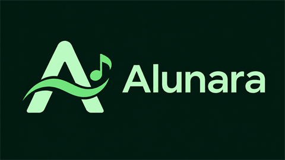
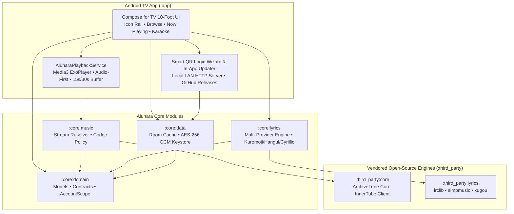

<div align="center">

  <a href="https://github.com/Kh1zZ/Alunara/releases/latest">
    
  </a>

  <p>
    <strong>Alunan Suara — Let the Music Flow.</strong>
    <br />
    A serene, audio-only YouTube Music player engineered from scratch for Android TV remotes and 1 GB RAM smart TVs.
  </p>

  <p>
    <a href="https://github.com/Kh1zZ/Alunara/releases/latest"></a>
    <a href="https://github.com/Kh1zZ/Alunara/releases"></a>
    <a href="https://github.com/Kh1zZ/Alunara/actions/workflows/ci.yml"></a>
    
    
    <a href="LICENSE"></a>
  </p>

  <p>
    <a href="#philosophy--visual-language">Philosophy</a> &nbsp;·&nbsp;
    <a href="#crafted-for-the-10-foot-living-room">Highlights</a> &nbsp;·&nbsp;
    <a href="#tv-screen-previews">Previews</a> &nbsp;·&nbsp;
    <a href="#architecture">Architecture</a> &nbsp;·&nbsp;
    <a href="#getting-started-on-android-tv">Install</a> &nbsp;·&nbsp;
    <a href="#building--verification">Build</a> &nbsp;·&nbsp;
    <a href="CHANGELOG.md">Changelog</a>
  </p>

</div>

---

## At a Glance

Television living rooms deserve a calmer music experience than a stretched phone UI or a heavy video player. **Alunara** (`com.alunara.app`) strips away video decoding, ad clutter, and visual glare to deliver a responsive, D-pad-first listening space built natively with **Kotlin**, **Jetpack Compose for TV**, and **AndroidX Media3**.

| Dimension | Alunara Engineering Target |
| :--- | :--- |
| **Memory Footprint** | **~72 MB PSS** on entry-level **1 GB RAM** Android TVs (R8 full-mode + `RGB_565` artwork) |
| **Navigation Smoothness** | **60 FPS** D-pad focus routing with a fixed `72.dp` pure icon rail and zero-relayout GPU progress bar |
| **Audio Pipeline** | Audio-only AAC/MP4A and Opus streams ranked by URL availability and the selected bitrate preset |
| **Lyrics & Scripts** | `100 ms` decoupled **Calm Vocal Sweep & Center Glide** karaoke sync (`[offset:±ms]`, `endTimeMs`, CJK normalization) + single-pass offline **Romaji / Hangul / Cyrillic** |
| **App Updates** | Built-in **GitHub Releases** updater with automatic ABI selection (`arm64-v8a` / `armeabi-v7a`) and direct Android TV `PackageInstaller` handoff |
| **Sign-In Experience** | **Smart Phone QR & Pairing Code Wizard** via [`kh1zz.github.io/Alunara/login`](https://kh1zz.github.io/Alunara/login) and local LAN HTTP — zero on-screen remote typing |
| **Privacy & Licensing** | **Zero ads, zero telemetry**, guest mode out of the box, 100% open source under **GNU GPL v3.0** |

---

## Philosophy & Visual Language

**Alunara** is born from the Indonesian phrase ***"Alunan Suara"*** — *a gentle, unhurried flow of sound*. Every architectural and visual choice serves three principles: **Flow**, **Harmony**, and **Tranquility**.

> *"Alunara is not simply about playing music — it is about allowing every melody to find its own space."*

### Identity Marks
- **Geometric "A"** — Rounded, balanced anchor that stays legible from ten feet away.
- **Flowing Sound Wave** — An organic ribbon passing through the mark to evoke continuous rhythm.
- **Integrated Musical Note** — Subtle, clutter-free cue woven directly into the wave's motion.

### Fixed Dark Forest Green Palette
Rather than shifting colors aggressively with every album cover, Alunara locks its interface to a calibrated **Dark Forest Green** system designed for low-glare evening viewing on large television panels (with an optional High-Contrast mode in Settings):

| Role | Token (`AlunaraPalette`) | Swatch | Living-Room Purpose |
| :--- | :--- | :---: | :--- |
| **Canvas** | `Background` |  | Deep forest backdrop that minimizes TV backlight glare |
| **Card / Rail** | `Surface` |  | Calm elevation layer for rails, cards, and modals |
| **Elevated Control** | `SecondarySurface` |  | Subtle depth for inputs, chips, and queue rows |
| **Primary Accent** | `PrimaryAccent` |  | Soft mint indicator for playback progress and active states |
| **D-Pad Focus** | `FocusOutline` |  | High-visibility `2.5.dp` focus ring readable across the room |
| **Typography** | `PrimaryText` |  | Warm mint-tinted white for fatigue-free reading & lyrics |

---

## Crafted for the 10-Foot Living Room

### 1. D-Pad Native UI & 60 FPS Budget
- Built exclusively for television geometry (`960×540 dp` logical 720p grid with TV overscan margins).
- **Pure icon-only left navigation rail (`72.dp`)** maximizes horizontal stage space without width transitions or black-frame flicker.
- GPU-drawn `drawBehind` mini-player progress strip eliminates layout passes while browsing Home, Search, Library, or Settings.
- Coil downscaled `RGB_565` artwork caching and a lightweight `240px` blurred backdrop keep bitmap allocations tight on low-memory hardware.
- Built-in **Text Scaling**, **High-Contrast**, **Reduce Motion**, and a focus-locked **trilingual language switcher** (English, Bahasa Indonesia, Japanese).

### 2. Audio Engine
- Streams **audio-only** YouTube Music tracks with zero video decoder overhead.
- Prefers direct stream URLs. AAC/MP4A and Opus follow the same bitrate rules across all quality presets.
- `Low`, `Medium`, and `Auto` target 80, 160, and 192 kbps respectively. `High` selects the highest bitrate in the preferred stream pool.
- Powered by a single-instance Media3 `AlunaraPlaybackService` with tuned `DefaultLoadControl` buffering (`15s` min / `30s` max / `2 MB` target), native TV Now Playing session integration, Up Next queue management, Shuffle/Repeat, and persistent session restore.

### 3. Synchronized Karaoke Lyrics & Offline Romanization
- **Calm Vocal Sweep & Center Glide:** center-anchored smooth scroll (`animateScrollBy`), minimalist Forest-Mint active bar indicator, subtle three-dot instrumental intro cue, and zero-recomposition GPU `clipRect` vocal sweep fill on singing tokens (with automatic single-text simplification under `Reduce Motion`).
- Decoupled `100 ms` active-line sync via `activeLyricIndexFlow`, global LRC `[offset:±ms]` support, accurate word-level `endTimeMs` spans, and CJK-aware intra-token whitespace normalization for clean upstream word-sync tokenization.
- Bounded multi-provider engine (**SimpMusic**, **LRCLIB**, **KuGou**) with adaptive provider reliability scoring and Room caching (`LRC_V2`).
- **Built-in single-pass offline romanization** for **Japanese (Kuromoji)**, **Korean Hangul**, and **Cyrillic** scripts directly on the TV.

### 4. Zero-Typing Smart Phone QR & Pairing Portal
- Start sign-in on your TV, scan the on-screen QR code, or open [`https://kh1zz.github.io/Alunara/login`](https://kh1zz.github.io/Alunara/login) on your phone and enter the compact **TV Pairing Code** — no typing raw local IP/port URLs. Your phone displays a live **"Sign-In Complete"** confirmation popup as soon as the TV authenticates.
- Bi-directional **YouTube Music Account Sync**: create and add/remove tracks in playlists, save/unsave external playlists, subscribe/unsubscribe artists, sync likes with optimistic rollback on failure, and report playback to your listening history while keeping signed-in and guest caches strictly isolated via `accountScope`.
- Credentials are sealed at rest using hardware-backed Android Keystore (**AES-256-GCM**).

### 5. Private, Lightweight & Ready Without an Account
- Launch and stream immediately in **Guest Mode** with zero mandatory login.
- Local Room database caches Home and Library surfaces for instant cold-start browsing.
- Completely free of ads, analytics, crash trackers, or third-party telemetry SDKs.

### 6. Seamless In-App Auto-Update
- Automatically checks [`Kh1zZ/Alunara/releases/latest`](https://github.com/Kh1zZ/Alunara/releases/latest) at startup (when Auto-Update is enabled) or on demand via **Settings → App Updates**.
- Matches the TV's CPU ABI (`arm64-v8a` or `armeabi-v7a`) automatically, downloads the signed split APK directly inside Alunara with live progress, and hands off immediately to Android TV's system `PackageInstaller`.

---

## TV Screen Previews

<div align="center">

| Home & Pure Icon Rail | Now Playing & Karaoke Lyrics |
| :---: | :---: |
|  |  |
| **Library & Playlists** | **Smart Phone QR Login Wizard** |
|  |  |

</div>

> [!NOTE]
> These 16:9 frames are Alunara-themed placeholders reserved for final Android TV captures under `docs/screenshots/`.

---

## Architecture

Alunara follows a clean **modular-lite** Gradle layout that isolates Android TV UI, Media3 playback, domain contracts, local persistence, and vendored upstream engines:



---

## Getting Started on Android TV

Official signed builds are published **exclusively on [GitHub Releases](https://github.com/Kh1zZ/Alunara/releases/latest)** as compact per-ABI split APKs.

| Release Artifact | CPU ABI | Target Android TV Hardware |
| :--- | :---: | :--- |
| `alunara-<version>.armv7a.apk` | `armeabi-v7a` (32-bit) | Most 1 GB / 2 GB RAM smart TVs, Mi TV Stick, Changhong, and entry-level TV boxes |
| `alunara-<version>.armv8a.apk` | `arm64-v8a` (64-bit) | 64-bit Android TVs, NVIDIA Shield TV, and modern Google TV streamers |

<details>
<summary><strong>Installation Steps (ADB, USB Drive, or Downloader)</strong></summary>

#### Option A — Install over Network via ADB (Fastest)
1. Enable **Developer Options → Network / USB Debugging** on your Android TV.
2. Connect from your computer and install the APK matching your TV's ABI:
   ```bash
   adb connect <YOUR_TV_IP>:5555
   adb install -r alunara-0.2.4.armv7a.apk
   ```
   *(Replace with `alunara-0.2.4.armv8a.apk` for 64-bit `arm64-v8a` devices. Once installed, future releases can be downloaded and installed directly inside **Settings → App Updates**.)*

#### Option B — USB Flash Drive or TV Downloader App
1. Download the matching APK directly from [GitHub Releases](https://github.com/Kh1zZ/Alunara/releases/latest).
2. Transfer it to your TV via USB drive or a TV Downloader utility.
3. Open the APK using a TV file manager and grant **Install unknown apps** when prompted.

</details>

> [!IMPORTANT]
> - **Official Distribution Only:** Alunara is **not** published on Google Play or third-party app stores. Always verify downloads come directly from [Kh1zZ/Alunara Releases](https://github.com/Kh1zZ/Alunara/releases).
> - **Regional Availability:** In regions where YouTube Music is unavailable, a VPN or proxy routed to a supported region may be needed to fetch catalog data.

---

## Building & Verification

### Requirements
- **JDK 21** and Android SDK (`minSdk 28`, `compileSdk 35`, `targetSdk 35`)
- Local `local.properties` pointing to your Android SDK (and `keystore.properties` based on [`keystore.properties.example`](keystore.properties.example) for signed release builds)

### Common Gradle Tasks
```bash
# Run all 123 JVM unit tests across 25 test suites
./gradlew :core:domain:test :core:music:test :core:lyrics:test :core:data:testDebugUnitTest :app:testDebugUnitTest

# Run Android Lint on debug sources (signed R8 split release APKs are built via GitHub Actions)
./gradlew :app:lintDebug
```
*(On Windows, use `.\gradlew.bat`. Release APK builds run via [`.github/workflows/release.yml`](.github/workflows/release.yml).)*

### Localization & Project Documentation
- **UI Languages:** Built-in **English** (`values`), **Bahasa Indonesia** (`values-in`), and **Japanese (`日本語`)** (`values-ja`), plus offline lyrics romanization for Japanese, Korean, and Cyrillic. Community translations via Pull Requests are warmly welcomed.
- **Engineering Docs:** [`CHANGELOG.md`](CHANGELOG.md) · [`CREDITS.md`](CREDITS.md) · [`KNOWN_ISSUES.md`](KNOWN_ISSUES.md) · [`AGENTS.md`](AGENTS.md) · [`M5 Release Report`](docs/M5_RELEASE_REPORT.md)

---

## Credits, Contributors & License

### Open-Source Foundations
Alunara's Android TV frontend and application layer are independently authored, standing on the shoulders of great open-source projects (full audit & commit provenance in [`CREDITS.md`](CREDITS.md)):

- **[ArchiveTune Core](https://github.com/rukamori/core)** & **[ArchiveTune Lyrics](https://github.com/rukamori/lyrics)** by [rukamori](https://github.com/rukamori) — vendored GPL-3.0 InnerTube and modular lyrics provider engines (`lrclib`, `simpmusic`, `kugou`).
- **[Kuromoji](https://github.com/atilika/kuromoji)** by Atilika — offline Japanese morphological tokenizer powering Romaji conversion.
- **NewPipe Extractor**, **AndroidX Media3**, **Jetpack Compose for TV**, **Coil**, **Ktor**, and **Room**.

### Contributors
<a href="https://github.com/Kh1zZ/Alunara/graphs/contributors">
  
</a>

<br />

 — Architecture, 60 FPS Android TV optimization, precision lyrics synchronization, and documentation.

### Independence & GPL-3.0 License
Alunara is an independent open-source project and is **not** affiliated with, endorsed by, or sponsored by Google LLC, YouTube, or ArchiveTune. It does not circumvent YouTube's technical protections — please support artists through official platforms whenever possible.

Distributed under the **GNU General Public License v3.0 (GPL-3.0)**. See [`LICENSE`](LICENSE) for full terms and [`CREDITS.md`](CREDITS.md) for third-party notices.

---

<div align="center">
  
  <br />
  <sub><strong>Alunara</strong> · <em>Let the Music Flow.</em></sub>
</div>
